<p align="center">
  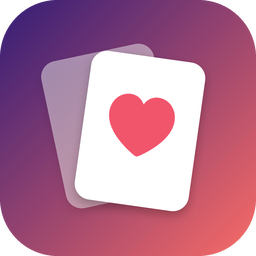
</p>

<h1 align="center">SongSort</h1>

<p align="center"><b>Tinder for your Spotify library.</b><br>One song at a time, played from the middle. Swipe right to keep, left to reject.</p>

<p align="center">
  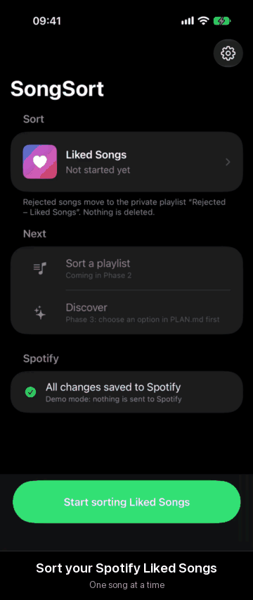
  &nbsp;&nbsp;
  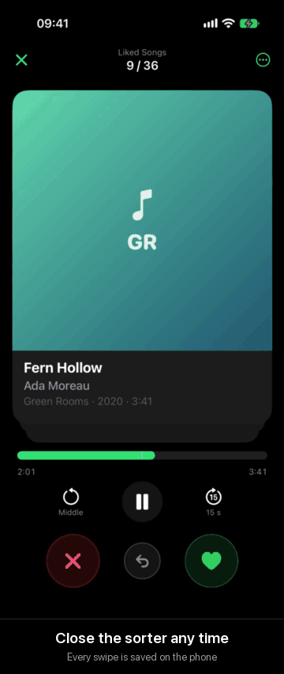
</p>

SongSort is a personal iPhone app for cleaning up your Spotify Liked Songs. It shows one song at a time and plays it from about the middle in the Spotify app. Swipe right to keep it, left to reject it. A rejected song moves to a private "Rejected – Liked Songs" playlist, so nothing is ever deleted.

**Status:** Phase 1 (login + Sort Liked Songs) is built, with 102 passing tests. Sort a playlist is Phase 2. Discover is Phase 3 and waits for a decision in [PLAN.md §4](PLAN.md).

## Screens

<table>
  <tr>
    <td align="center" width="25%">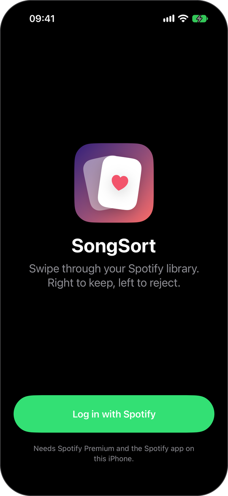<br><sub><b>Log in</b><br>Spotify login with PKCE, no secret in the app</sub></td>
    <td align="center" width="25%">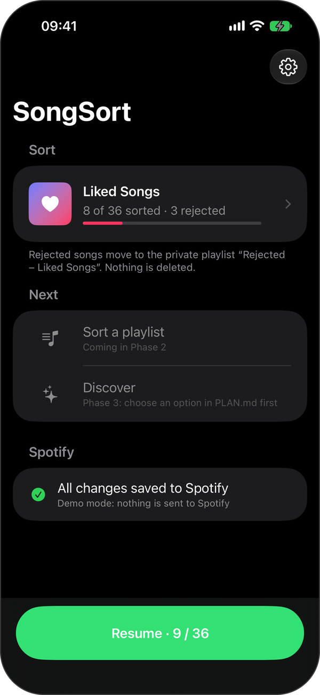<br><sub><b>Home</b><br>Progress and sync status</sub></td>
    <td align="center" width="25%">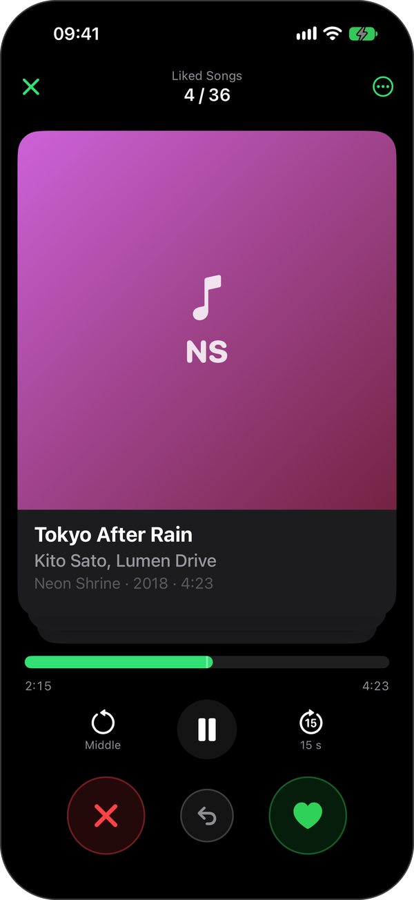<br><sub><b>Sorter</b><br>Each song starts at its middle</sub></td>
    <td align="center" width="25%">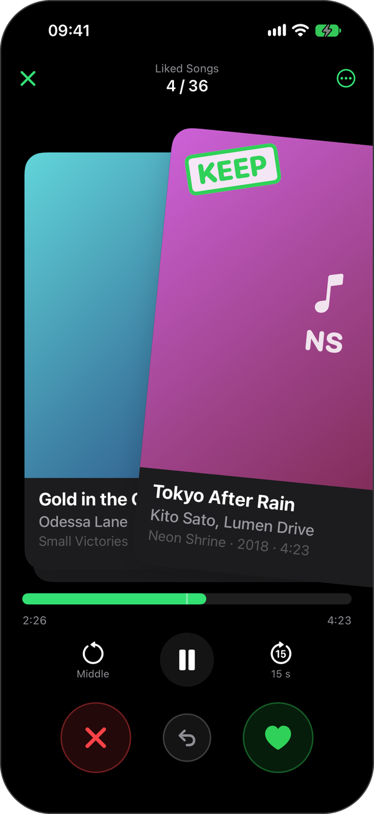<br><sub><b>Swipe</b><br>Right keeps, left rejects</sub></td>
  </tr>
  <tr>
    <td align="center">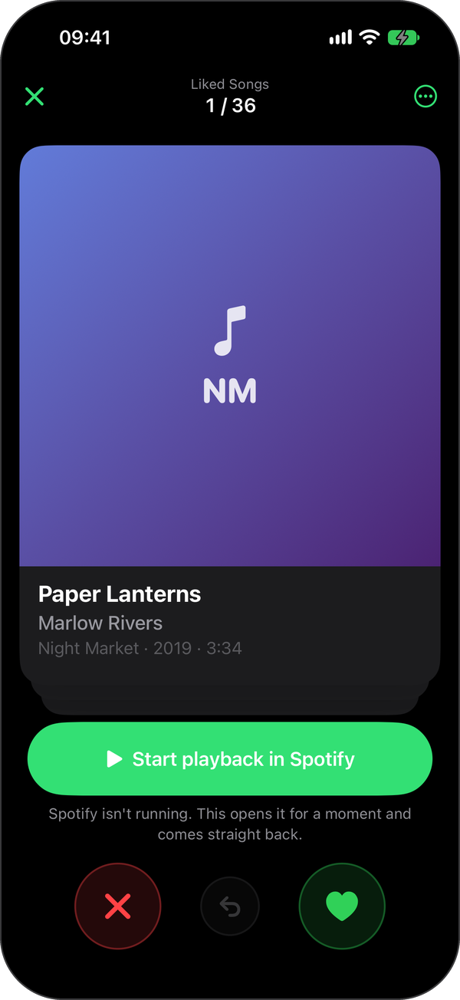<br><sub><b>Spotify not running</b><br>One tap starts playback</sub></td>
    <td align="center">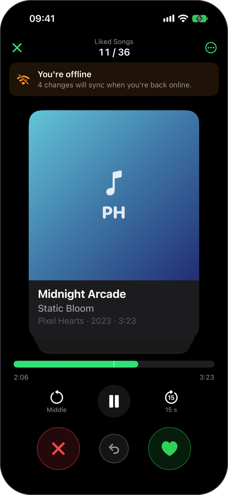<br><sub><b>Offline</b><br>Swipes are saved and sync later</sub></td>
    <td align="center">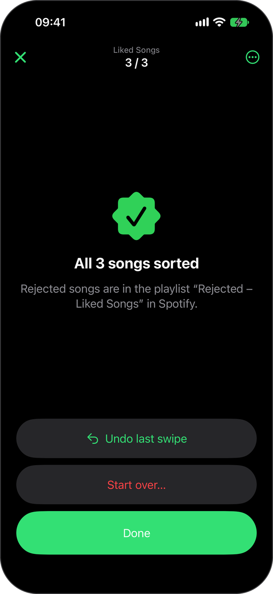<br><sub><b>All sorted</b><br>Undo or start over</sub></td>
    <td align="center">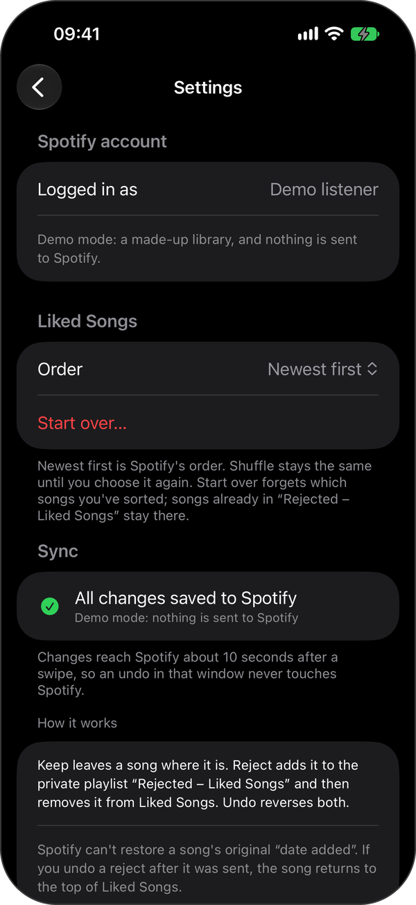<br><sub><b>Settings</b><br>Order, start over, sync</sub></td>
  </tr>
</table>

▶️ **[Watch the 29-second walkthrough](docs/media/walkthrough.mp4)** (MP4, with captions)

<sub>Everything above was recorded in the iOS Simulator with SongSort's [demo mode](#simulator-demo-mode): a made-up library and a simulated player, so no real account or music appears.</sub>

## How a reject reaches Spotify

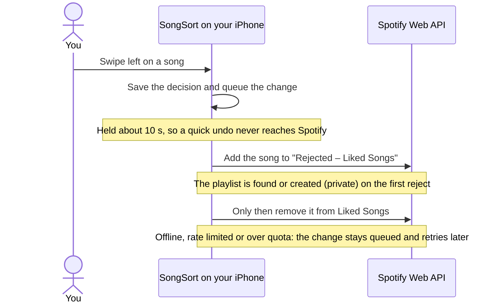

Decisions and pending changes are saved together on the phone, so quitting the app never loses a swipe. Undo cancels a change that hasn't been sent yet, and reverses one that has. Details are in [PLAN.md §3](PLAN.md).

## Setup

You need:
- A Mac with Xcode (built and tested with Xcode 27.2)
- An iPhone on iOS 17 or later, with the Spotify app installed and logged in
- Spotify Premium (needed both for on-demand playback and for Spotify's developer "Development Mode")
- An Apple ID. A free one works, but its builds expire after 7 days.

### 1. Register the app with Spotify (5 minutes)

1. Open <https://developer.spotify.com/dashboard> and log in with **your Premium Spotify account**.
2. Click **Create app** and fill in:
   | Field | Value |
   |---|---|
   | App name | `SongSort` (anything works; it shows on the consent screen) |
   | App description | `Personal library sorter` |
   | Website | leave empty |
   | **Redirect URIs** | `songsort://callback` exactly, all lowercase. Click **Add** |
   | **Which API/SDKs are you planning to use?** | tick **Web API** and **iOS** |
3. Tick the Developer Terms checkbox and click **Save**.
4. Open the app → **Settings** → **Edit**. Under **iOS app bundles**, add the **Bundle ID** you'll use in step 2 below, e.g. `com.yourname.songsort`. Leave **Android packages** empty. Click **Save**.
5. Copy the **Client ID** from **Settings → Basic Information**. You don't need the Client Secret; SongSort uses PKCE.
6. *Only if you log in to SongSort with a different Spotify account than the one that owns the app:* add that account under **Settings → User Management**. Otherwise Spotify answers "User not registered in the Developer Dashboard", and SongSort shows that message.

### 2. Configure the project

```bash
cp Config/Local.example.xcconfig Config/Local.xcconfig
```

Edit `Config/Local.xcconfig` (it's git-ignored):

```
SPOTIFY_CLIENT_ID  = <your 32-character Client ID>
SONGSORT_BUNDLE_ID = com.yourname.songsort   // same value you entered under "iOS app bundles"
DEVELOPMENT_TEAM   = <your Apple Team ID>
```

To find your Team ID: in Xcode → **Settings → Accounts**, select your Apple ID. The team is listed there, and the 10-character ID appears when you pick it in the project's **Signing & Capabilities** tab. Choosing the team in **Signing & Capabilities** also works instead of `DEVELOPMENT_TEAM`.

### 3. Run it on your iPhone

1. Open `SongSort.xcodeproj`. On first open, Xcode fetches the official Spotify iOS SDK (`github.com/spotify/ios-sdk`, v5.0.1) via Swift Package Manager.
2. Connect your iPhone with a cable, unlock it, and tap **Trust**. If iOS asks, turn on **Settings → Privacy & Security → Developer Mode** and restart the phone.
3. Pick your iPhone as the run destination and press **⌘R**.
4. *Free Apple ID only:* on the iPhone, go to **Settings → General → VPN & Device Management**, trust your developer profile, and launch again.

---

## iPhone checklist (what I couldn't test in the Simulator)

The Spotify app doesn't run in the Simulator, and logging in needs your password, so please run these on the phone. Each step says what you should see.

1. **Login.** Launch SongSort and tap **Log in with Spotify**. Spotify's consent page opens in a sheet (log in if asked), tap **Agree**. → Home appears, and the bottom section says *Logged in as \<your name\>*.
2. **Stays logged in.** Swipe SongSort away in the app switcher and reopen it. → It goes straight to Home, with no login.
3. **First card.** Tap **Start sorting Liked Songs**. → "Loading Liked Songs… x of N" for a moment, then your most recently liked song. You see cover art, title, artists, *Album · Year · m:ss*, and the counter **1 / N**.
4. **Auto-play from the middle.** If Spotify was already running, the song starts by itself within about a second, and the progress bar starts at its middle tick. If not, you see **Start playback in Spotify**: tap it, Spotify opens for a moment (the first time it asks you to agree), then you're back and the song plays from the middle. *Tell me if you hear a split second of the song's beginning before it jumps.*
5. **Keep.** Swipe right, or tap ♥. → The card flies right, the next song starts from its middle without a loading screen, and the counter reads **2 / N**.
6. **Reject.** Swipe left, or tap ✕. Wait about 15 seconds, then look in the Spotify app. → There's a new private playlist **"Rejected – Liked Songs"** containing that song, and the song is gone from Liked Songs.
7. **Quick undo.** Reject a song and tap ↶ straight away. → The card comes back and plays again, and nothing changes in Spotify.
8. **Late undo.** Reject a song, wait 15 seconds, then tap ↶. → The song is back in Liked Songs (at the top, with today's date, because Spotify's API can't restore the original date) and gone from "Rejected – Liked Songs".
9. **Controls.** Pause and play, **Middle** (jumps to the tick), **15 s** (jumps ahead 15 seconds), and dragging the progress bar all work.
10. **Quit and resume.** Note the counter (say **8 / N**), swipe SongSort away, and reopen it. → Home shows *7 of N sorted* and **Resume · 8 / N**. Tapping it continues at the next unsorted song, and songs you've sorted don't come back.
11. **Offline.** Turn on Airplane Mode and reject a song. → A banner says *You're offline — 2 changes will sync when you're back online*. Turn Airplane Mode off. → Within a few seconds the banner goes away and Spotify shows the change.
12. *(Optional)* **Already rejected.** In Spotify, add a liked song to "Rejected – Liked Songs" yourself, then reject it in SongSort. → It appears there only once.
13. *(Optional)* **Log out.** Go to **Settings → Log out**. → The login screen appears. Log in again. → Home shows your progress as before.

---

## Using SongSort

- **Keep** (swipe right or ♥) leaves the song in Liked Songs. **Reject** (swipe left or ✕) adds it to "Rejected – Liked Songs" and only then removes it from Liked Songs.
- Changes reach Spotify about **10 seconds** after a swipe, in batches. An undo within those 10 seconds never touches Spotify. Leaving the sorter or the app sends them immediately.
- **Undo** (↶) steps back through your last 100 decisions, even after a relaunch.
- **⋯ menu** in the sorter: order (*Newest first*, *Oldest first*, *Shuffle*), **Open in Spotify**, **Start over…**
- **Start over** forgets which songs you've sorted. Songs already in "Rejected – Liked Songs" stay there.
- **Settings** (gear on Home): log out (your progress stays), order, start over, and sending waiting changes now.

## Simulator demo mode

Debug builds have a demo mode with a made-up library and a simulated player, so you can try every screen without a Spotify account. In Xcode, open **Product → Scheme → Edit Scheme → Run → Arguments** and enable `-SongSortDemo YES`. Other switches:

| Argument | Effect |
|---|---|
| `-SongSortDemoReset YES` | Start from scratch |
| `-SongSortDemoLibrary empty` / `small` | Empty Liked Songs / only 3 songs |
| `-SongSortDemoPlayer needsStart` / `notInstalled` | Spotify not running / not installed |
| `-SongSortDemoOffline writes` / `YES` | Saving changes fails offline / everything fails offline |
| `-SongSortDemoWriteError login` / `quota` / `forbidden` | Saving changes fails: login expired / quota reached / Spotify refuses |

## Tests

The logic (queue order, skipping sorted songs, resume, undo, Rejected playlist naming and creation, sync batching and failures, API request shapes, PKCE and tokens) lives in the `SongSortCore` package, which has 102 tests:

```bash
cd SongSortCore && swift test
```

Or open `SongSortCore/Package.swift` in Xcode and press **⌘U**. That runs them on the iOS Simulator.

## Troubleshooting

| You see | Fix |
|---|---|
| "Spotify Client ID missing" | Step 2: create `Config/Local.xcconfig`, then rebuild |
| Spotify page says **INVALID_CLIENT: Invalid redirect URI** | The dashboard's Redirect URI must be exactly `songsort://callback` |
| "Spotify rejected the login code" | Same as above. Also check the Client ID |
| "User not registered in the Developer Dashboard" | Step 1.6: add your account under User Management |
| **Start playback** keeps coming back | Make sure the Bundle ID in the dashboard (step 1.4) matches `SONGSORT_BUNDLE_ID`, and that you're logged in to the Spotify app |
| "Spotify's limit for your developer account was reached" | Development-mode quota. Swipes are saved and sync later |
| "Spotify isn't installed" | Install Spotify from the App Store and log in |

## How it's built

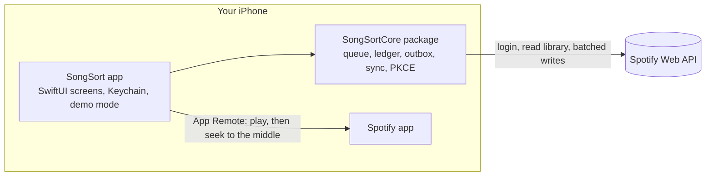

```
SongSort/              SwiftUI app: login, Home, sorter, settings, App Remote player, demo mode
SongSortCore/          Swift package with all the logic and the tests
Config/                Build settings (your Local.xcconfig goes here) and Info.plist additions
docs/media/            Screenshots, GIFs and the walkthrough video used in this README
PLAN.md                Acceptance criteria, Spotify API constraints, phases, Discover options
```

- **Spotify Web API** for the library and playlists: `GET /me/tracks`, `PUT/DELETE /me/library`, `/playlists/{id}/items`, `POST /me/playlists` (the endpoints available to new apps since February 2026).
- **Spotify iOS SDK (App Remote)** plays songs in the Spotify app (Premium, on demand).
- Login is **Authorization Code + PKCE**. Tokens live in the iOS Keychain. Your progress and pending changes live in one JSON file in the app's Application Support folder. Nothing is sent anywhere except to Spotify.
